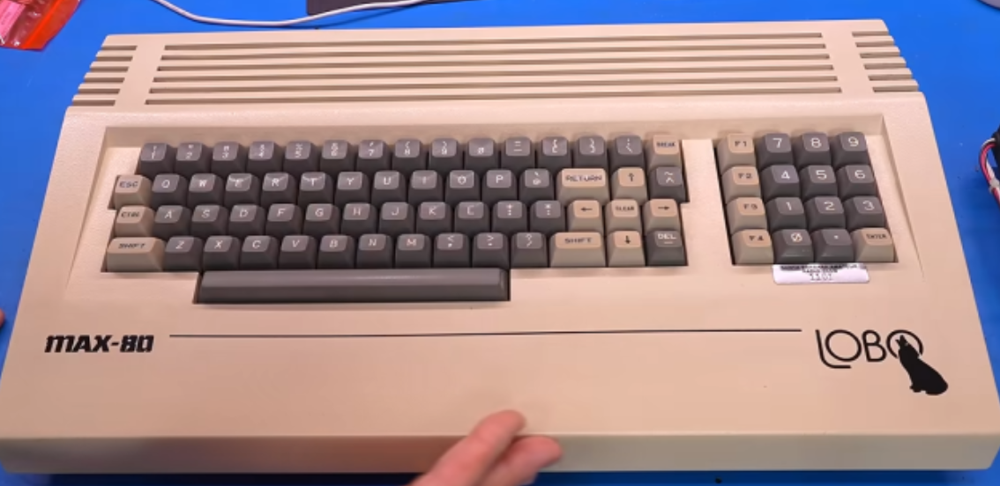

# LOBO MAX-80 · Keyboard Logic Board

This KiCad 10 project recreates the keyboard logic board from sheet 5 of the original LOBO MAX-80 schematics. The board scans the keyboard matrix and connects the mainboard to the hard disk and parallel printer interfaces. It also carries the boot-selection DIP switch and reset button.

## Opening the project

Open [MAX-80-Keyboard.kicad_pro](MAX-80-Keyboard.kicad_pro) in KiCad 10. The [schematic](MAX-80-Keyboard.kicad_sch) shows the switch matrix and interface logic. The [PCB layout](MAX-80-Keyboard.kicad_pcb) contains 106 footprints, including 76 keyboard switches. PCB routing is still pending.

## Keyboard layout

The rebuild uses plate-mounted Cherry MX switches on a 19.05 mm pitch. The staggered rows follow the reference photo, with F1–F4 down the left side of the numeric keypad and Enter in its lower-right corner.

| Keys | Count | Keycap width |
| --- | ---: | ---: |
| Letters, digits, punctuation, and other single-width keys | 72 | 1u |
| Return and both Shift keys | 3 | 1.5u |
| Space bar | 1 | 8u |

The wide key sizes are estimates from the photo. The space bar stabilizer spacing and fit to the original case still need a physical check.

The numeric keypad shares matrix positions with the main keyboard. Switches K66–K76 implement the keypad digits and decimal point, each wired in parallel with its counterpart. Keypad Enter shares the Return matrix position. The original matrix is documented on page TS-17 of the [MAX-80 Technical Reference Manual](../MAX-80_MAINBOARD/Tech_Ref_Manual_Updated.pdf#page=65).

## Board connections

| Connector | Function | Footprint |
| --- | --- | --- |
| J7 | Mainboard interface | 34-pin male header, 2 × 17, 2.54 mm pitch |
| J8 | Winchester hard disk interface | 50-contact card edge |
| J9 | Parallel printer interface | 34-contact card edge |

## Libraries and original drawings

The project includes two [symbol libraries](sym-lib-table). The [keyboard footprint library](MAX80_KeyboardParts.pretty) contains the two card-edge connectors, reset switch, DO-7 diode, and 8u space bar footprint. Other parts use the standard KiCad libraries.

- [Original schematic, sheet 5](../MAX-80_MAINBOARD/5.png)
- [Original keyboard logic board placement drawing](../MAX-80_MAINBOARD/Keyboard%20logic%20board.png)
- [Companion CPU Logic Board project](../MAX-80_MAINBOARD/README.md)
